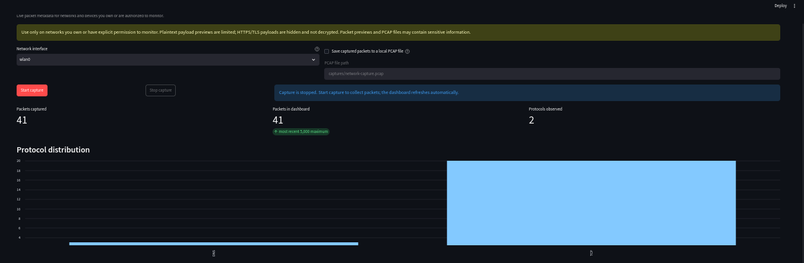

# Basic Network Sniffer

A beginner-friendly Python and Streamlit dashboard for monitoring packet metadata on a network you own or are explicitly authorized to observe. Scapy captures live packets; the dashboard summarizes protocols and lets you filter and export packet details.

## Dashboard screenshot

Example dashboard after a live capture showing 41 packets and the protocol distribution. The packet table is omitted from this public screenshot to avoid exposing captured IP addresses.



## What it does

- Captures packets on a selected interface, including `wlan0` when present.
- Displays timestamp, source/destination IP addresses, TCP/UDP ports, protocol, packet size, a short protocol explanation, and a bounded plaintext payload preview.
- Recognizes DNS, TCP, UDP, ICMP, ARP, and other traffic.
- Filters by protocol, source IP, destination IP, or either-side port.
- Shows packet totals and protocol distribution; retains the most recent 5,000 packet metadata records in memory.
- Exports filtered metadata to CSV. Optionally writes a PCAP file locally.
- Hides TLS/HTTPS payloads, omits HTTP headers and request bodies from previews, and does not decrypt encrypted traffic.

> **Authorization and privacy:** Capture only on networks and devices you own or are authorized to monitor. Plaintext payload previews are limited to 96 bytes but can still contain sensitive information. HTTP previews show only the request line; headers and body are omitted. A PCAP file contains captured packets and may include unencrypted application data. Keep exports private and delete them when no longer needed. The app does not decrypt HTTPS/TLS.

## Project structure

```text
network-sniffer/
├── app.py                 # Streamlit UI and dashboard
├── requirements.txt
├── README.md
├── sniffer/
│   ├── __init__.py
│   ├── analysis.py        # Metadata extraction and protocol explanations
│   ├── capture.py         # Scapy capture thread and optional PCAP writing
│   └── export.py          # CSV generation
└── tests/
    ├── test_analysis.py
    └── test_export.py
```

## Install and run on Kali Linux

Open a terminal in this project directory:

```bash
sudo apt update
sudo apt install -y python3 python3-venv python3-pip
python3 -m venv .venv
source .venv/bin/activate
python -m pip install --upgrade pip
python -m pip install -r requirements.txt
```

Start the dashboard with packet-capture privileges:

```bash
sudo .venv/bin/streamlit run app.py
```

If your shell cannot locate the virtual environment when using `sudo`, use the explicit executable above. Streamlit prints a local URL, normally `http://localhost:8501`; open it in a browser on the Kali machine. To stop the web app, press `Ctrl+C` in the terminal.

In the dashboard, select an interface, optionally enable PCAP saving and choose a local file path, then click **Start capture**. Use **Stop capture** when finished. The table and counters refresh every two seconds. Use the filters to narrow the view, then download the visible rows as CSV.

## Demonstration workflow for an evaluator

1. Explain that capture is limited to an authorized interface and that HTTPS/TLS contents are not decrypted.
2. In a terminal, inspect interfaces with `ip link` and note the interface connected to your test network (for example, `wlan0`).
3. Run the app, select that interface, and start capture.
4. In another terminal or browser, generate ordinary authorized traffic, for example:

   ```bash
   ping -c 3 1.1.1.1
   curl -I https://example.com
   ```

5. Point out ICMP echo request/reply packets from `ping`, DNS queries if name resolution occurs, and TCP connections for the HTTPS request. For port 443, the dashboard reports metadata only.
6. Filter by protocol, source/destination IP, or port; explain packet counts and the protocol distribution chart.
7. Download the filtered CSV. Optionally enable PCAP saving in a separate short demonstration and show that a PCAP was written to the chosen path.
8. Stop capture and explain that packet capture sees only traffic visible to the selected interface; switched networks, Wi-Fi mode, routing, and OS permissions can affect visibility.

Use only destinations and networks allowed by your internship or evaluator. Do not generate traffic against systems without permission.

## Troubleshooting

### Permission denied / `Operation not permitted`

Packet capture commonly requires elevated privileges. Run:

```bash
sudo .venv/bin/streamlit run app.py
```

Avoid running the whole application as root on a shared or untrusted machine. An administrator can instead configure narrowly scoped packet-capture capabilities for the relevant Python executable, but the exact Python path may change when the virtual environment is recreated. Do not grant capabilities to a general-purpose interpreter without understanding the security impact.

### No interface appears or `wlan0` is missing

List interfaces and their state:

```bash
ip link
ip addr
```

Interface names vary; wireless devices may use names such as `wlp2s0` rather than `wlan0`. Bring up only your own authorized interface using the system's normal network tools. The app lists interfaces reported by Scapy and does not enable monitor mode or alter interface settings.

### Capture starts but no packets appear

- Confirm that the selected interface is active and is the one carrying your test traffic.
- Generate ordinary traffic from the Kali machine, such as `ping` or `curl`.
- Packet visibility depends on the network topology and interface; this tool does not bypass switching or Wi-Fi encryption.
- Review the terminal running Streamlit for OS or driver errors.

### PCAP path cannot be written

Choose a path in a directory where the account running Streamlit has write permission, for example `captures/demo.pcap` under the project directory. PCAP output is created on the machine running Streamlit.

## Tests

With the virtual environment active and dependencies installed, run:

```bash
python -m pytest -q
```
